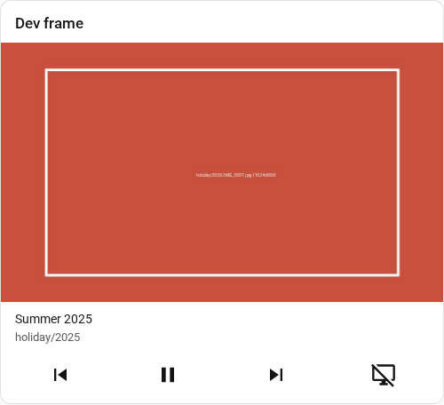
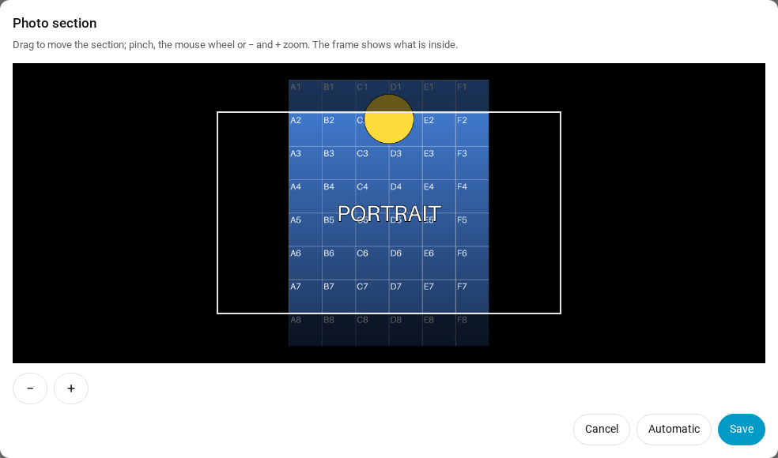
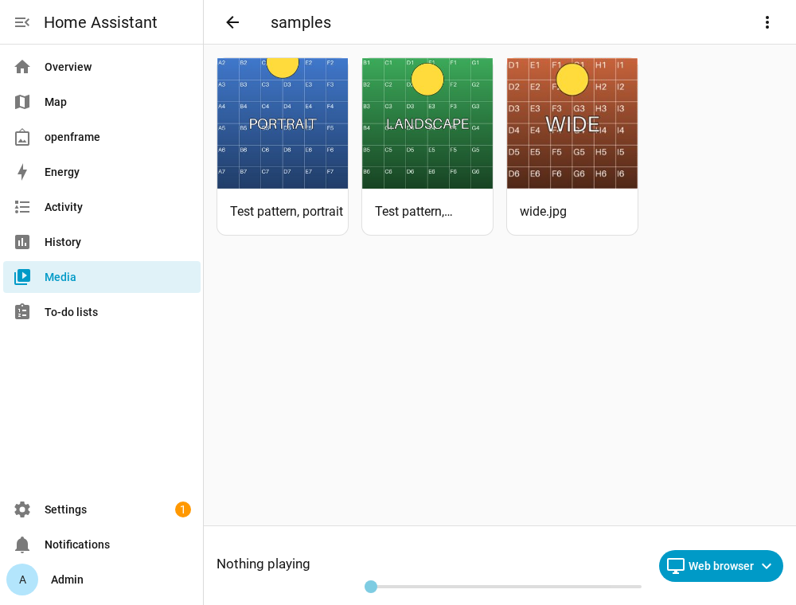

# ha-openframe

Home Assistant integration for [openframe](https://github.com/tycho991/openframe) picture frames.
Each frame becomes one device whose entities show and control the display, the slideshow, the
photo on screen, the settings that are useful in automations, the library and the frame's health.
All traffic stays on the local network: Home Assistant polls the frame.

## Requirements

- Home Assistant 2026.10 or later.
- openframe 0.6.0 or later on the frame. Older frames lack the brightness of the display and
  are refused during setup; a frame that is already added gets a repair issue until it is
  updated.

## Installation

### Marketplace (Home Assistant 2026.11 and later)

Home Assistant 2026.11 replaced HACS with its built-in Marketplace.

1. Settings › Marketplace › Add from link, enter `tycho991/ha-openframe` and, if asked, choose
   the type Integration.
2. Open "openframe", install the latest version and restart Home Assistant.

New releases then appear under Settings › Updates.

### HACS (Home Assistant 2026.10)

1. In HACS, open the menu › Custom repositories, add `https://github.com/tycho991/ha-openframe`
   with the type Integration.
2. Download "openframe" and restart Home Assistant.

### By hand

Copy `custom_components/openframe` from a release into the `custom_components` folder of your
Home Assistant configuration and restart Home Assistant. A copy by hand gets no update entity;
installing through the Marketplace later replaces it in the same folder.

### Updating from 0.1.0

Since 0.2.0 the display is a light with brightness instead of a switch: `switch.<frame>_display`
is removed and `light.<frame>_display` takes its place, for example `light.photo_frame_display`.
Home Assistant cannot move an entity from one domain to another, so a name, area or icon given to
the switch does not carry over.

1. Update the frames to openframe 0.6.0 first, with the `app` update entity of 0.1.0 or in the
   frame's web UI.
2. Then update the integration (Settings › Updates; after a copy by hand, install it through the
   Marketplace) and restart Home Assistant.
3. Search your automations, scripts, scenes and dashboards for `switch.photo_frame_display` (with
   your frame's name) and replace it with `light.photo_frame_display`; the actions
   `switch.turn_on` and `switch.turn_off` become `light.turn_on` and `light.turn_off`.

## Adding a frame

1. Settings › Devices & services › Add integration › openframe.
2. Enter the frame's IP address or host name and its port (8080 unless changed).
3. The frame shows a six-digit pairing code. Type it into Home Assistant.

The frame lists Home Assistant as a paired device named "Home Assistant" in its web UI. If the
pairing is revoked there, Home Assistant asks to pair again. If the frame gets a new IP address,
use Reconfigure on the frame's entry; no new pairing is needed. Removing the frame from Home
Assistant revokes its pairing on the frame.

## Dashboard card



The integration brings a dashboard card along and loads it by itself; no resource needs to be
added. It shows the photo on screen in the frame's shape, dimmed with "Display off" while the
display is off, badges for "Paused", "Safe mode" and "Unavailable", the caption of the photo, and
buttons for previous, play/pause, next and the display. Previous and next are disabled while the
display is off; the display button is hidden while the frame can neither switch nor dim its display.

Add it in a dashboard's edit mode with Add card › By card › openframe. Its editor offers the frame,
a title and whether to show the caption. In YAML:

```yaml
type: custom:openframe-card
device_id: 0123456789abcdef0123456789abcdef
title: Hall
show_caption: false
```

| Option | Default | Meaning |
|---|---|---|
| `device_id` | the first frame | The frame's device; the editor fills it in, and the device page's URL ends with it. |
| `title` | the device's name | The card's title. |
| `show_caption` | `true` | Show the comment or file name of the photo and its album below the photo. |

After an update of the integration, reload the page in the browser once to get the new card.

### Choosing the section and hiding the photo



For Home Assistant administrators the card shows two buttons on the photo, while a photo is on
screen and the frame is not in safe mode; they need Home Assistant 2026.10 and openframe 0.6.0 or
later, like the integration.

- **Choose section** opens an editor for the photo on screen. The frame's shape stays fixed and the
  whole photo moves behind it: drag to move the section; pinch, the mouse wheel or − and + zoom,
  from the whole photo with black borders to one photo pixel per screen pixel. What is inside the
  shape is what the frame shows. "Save" stores the section, "Automatic" removes it so that the
  frame's fill mode applies again, "Cancel" closes without a change. The editor keeps the photo it
  was opened for, also when the frame moves on.
- **Hide photo** asks in the card first, then hides the photo the card shows; it does not appear in
  the slideshow again. Show it again in the frame's web UI or with `openframe.set_photo_hidden`.

## Media browser



With Home Assistant 2026.10 and openframe 0.6.0 or later, the media browser (Media in the
sidebar) has an entry "openframe" with a folder per frame; with one frame it opens that frame's
folder directly. A frame's folder lists "All photos" and its albums, an album its sub-albums and
the photos directly in it, newest first and titled by their comment or file name. Hidden photos and
albums are marked "(hidden)". A folder lists at most 500 photos and says so in its title, for
example "holiday (500 of 1200)". Opening a photo shows it whole, at most 2048 pixels on its longest
edge.

Photos go through Home Assistant, so they are only shown to signed-in users and through links
Home Assistant signed for an hour; the frame's address and token stay in Home Assistant. A folder
is read from the frame when it is opened; while the frame does not answer or is in safe mode, the
folder says so. A photo the frame cannot render is listed without a thumbnail.

## Entities

Entity IDs follow the frame's name, for example `light.photo_frame_display` for a frame named
"Photo frame". The key is the end of each entity's unique ID.

| Key | Platform | What it does |
|---|---|---|
| `display` | light | Display on or off and its brightness; attributes `cause` (`schedule`, `manual`, `wake`, `none`), `next_change`, `dimmed` (the display schedule dims now) and `auto` (Android's automatic brightness is on). A brightness outside a dim period becomes the frame's fixed level. Only on and off while openframe may not modify system settings; switching fails while openframe is not a device administrator; unavailable when neither is allowed. |
| `slideshow` | switch | On while the slideshow plays, off while it is paused. |
| `next_photo`, `previous_photo` | button | Step through the slideshow. Fails while the display is off. |
| `current_photo` | image | The photo as the frame shows it. |
| `current_photo` | sensor | Comment of the photo, or its file name; attributes `album`, `taken_at`, `place`, `photo_id`. |
| `interval` | number | Seconds per photo (5 to 86400). |
| `transition_duration` | number | Milliseconds (0 to 5000). |
| `order` | select | `shuffle`, `chronological`. |
| `transition` | select | `fade`, `slide`, `none`. |
| `fill_mode` | select | `auto`, `fill`, `fit`. |
| `orientation` | select | `landscape`, `portrait`. |
| `brightness_mode` | select | `system` (Android's setting), `manual` (a fixed level, set with the light), `auto` (Android's automatic brightness, only on a frame with a light sensor). |
| `dim_level` | number | Brightness in percent while the display schedule dims (1 to 100); the dim times are set in the web UI. |
| `clock` | switch | Clock on the frame on or off. |
| `display_schedule` | switch | Display schedule on or off; its times are set in the web UI. Unavailable while openframe is not a device administrator. |
| `auto_update_check` | switch | The frame checks for a new version by itself. |
| `photos`, `photos_visible`, `photos_hidden` | sensor | Photo totals (diagnostic). |
| `albums` | sensor | Number of albums. |
| `album_<name>` | switch | On while the album is shown, attribute `photos`. One per album; sub-albums are disabled by default. |
| `sync_<source>` | button | Start a sync of a remote source. |
| `last_sync_<source>` | sensor | Time of the last sync; attributes `added`, `updated`, `removed`. |
| `sync_problem_<source>` | binary_sensor | On while the last sync failed; attribute `error`. |
| `app` | update | "openframe app": installed and latest openframe version with release notes. Installing opens Android's installation dialog on the frame's screen; confirm it there within 10 minutes. After a dialog that was cancelled or not confirmed, the frame refuses requests from Home Assistant for 30 minutes; "Install update" in the frame menu installs at once. |
| `check_update` | button | Ask the frame to check for an update now (diagnostic). |
| `safe_mode` | binary_sensor | On while the frame runs in safe mode after repeated crashes. |
| `leave_safe_mode` | button | Start the frame normally again; available only in safe mode. |
| `transition_fallback` | binary_sensor | On while the frame changes photos instantly because its display could not keep up (diagnostic). |

A new album or source gets its entities within 15 seconds. The entities of a removed album or
source stay and are unavailable, so automations that use them do not break silently; delete them
on the device page when they are no longer needed.

## Photo actions

The integration adds actions that change a frame's photos and albums. They target frames as
devices: in the automation editor, pick the frame; in YAML, give its device ID, the last part of
the address of the frame's page under Settings › Devices & services › Devices. Administrators,
automations and scripts may run them; for other users Home Assistant refuses them.

| Action | Fields | Response |
|---|---|---|
| `openframe.set_photo_hidden` | `photo_id` (optional), `hidden` | the photo |
| `openframe.set_photo_comment` | `photo_id` (optional), `comment` (empty removes it) | the photo |
| `openframe.set_photo_crop` | `photo_id` (optional), `x`, `y`, `zoom` or `reset: true` | the photo |
| `openframe.delete_photo` | `photo_id` (optional) | none |
| `openframe.upload_photo` | `file_path` (one or more), `album` (optional) | the new photos |
| `openframe.set_album_hidden` | `album`, `hidden` | none |

- Without `photo_id`, a photo action changes the photo each targeted frame shows at that moment.
  With `photo_id`, target exactly one frame. Photo IDs are in the responses of the actions.
- The section of `set_photo_crop` is a focus point (`x` and `y` from 0 to 1, left to right and top
  to bottom) and a `zoom`: 1 fills the screen, below 1 shows more of the photo with borders, above
  1 a detail, at most 4.
- `delete_photo` deletes only photos of the frame's own folder; photos of a Nextcloud share can only
  be hidden.
- `upload_photo` reads files only from folders Home Assistant may read: `/media` on Home Assistant
  OS and in Docker, other folders after adding them to
  [`allowlist_external_dirs`](https://www.home-assistant.io/integrations/homeassistant/#allowlist_external_dirs).
  The frame stores all files of a call or none of them.
- A response lists one entry per frame with `device_id`, `id`, `album`, `path`, `hidden`,
  `visible`, `comment` and `crop`; ask for it with `response_variable` in a script.

## Automation examples

Display off when nobody is home, on again when someone comes back:

```yaml
automation:
  - alias: Frame off when away
    triggers:
      - trigger: state
        entity_id: zone.home
        to: "0"
    actions:
      - action: light.turn_off
        target:
          entity_id: light.photo_frame_display
  - alias: Frame on when back
    triggers:
      - trigger: numeric_state
        entity_id: zone.home
        above: 0
    actions:
      - action: light.turn_on
        target:
          entity_id: light.photo_frame_display
```

Dim the frame while a movie runs, and back to full brightness afterwards. `light.turn_on` also
switches a display that is off on, so the condition leaves a frame that is off alone. A brightness
from Home Assistant outside a dim period becomes the frame's fixed level; for dimming every
evening, set a dim time in the frame's web UI and the `dim_level` instead.

```yaml
automation:
  - alias: Dim the frame for the movie
    triggers:
      - trigger: state
        entity_id: media_player.tv
        to: playing
        id: start
      - trigger: state
        entity_id: media_player.tv
        from: playing
        id: end
    conditions:
      - condition: state
        entity_id: light.photo_frame_display
        state: "on"
    actions:
      - action: light.turn_on
        target:
          entity_id: light.photo_frame_display
        data:
          brightness_pct: "{{ 20 if trigger.id == 'start' else 100 }}"
```

Pause the slideshow while the TV runs:

```yaml
automation:
  - alias: Pause the frame while the TV runs
    triggers:
      - trigger: state
        entity_id: media_player.tv
    actions:
      - action: >-
          {{ 'switch.turn_off' if trigger.to_state.state == 'playing' else 'switch.turn_on' }}
        target:
          entity_id: switch.photo_frame_slideshow
```

Next photo with a button on the wall:

```yaml
automation:
  - alias: Next photo
    triggers:
      - trigger: event
        event_type: zha_event
        event_data:
          command: single
    actions:
      - action: button.press
        target:
          entity_id: button.photo_frame_next_photo
```

Hide the photo on screen with a double press of the button on the wall; it does not come back in
the slideshow (replace the device ID with your frame's):

```yaml
automation:
  - alias: Hide this photo
    triggers:
      - trigger: event
        event_type: zha_event
        event_data:
          command: double
    actions:
      - action: openframe.set_photo_hidden
        target:
          device_id: 0123456789abcdef0123456789abcdef
        data:
          hidden: true
```

Show who rang the doorbell on the frame, in the album `visitors`:

```yaml
automation:
  - alias: Doorbell snapshot to the frame
    triggers:
      - trigger: state
        entity_id: binary_sensor.doorbell
        to: "on"
    variables:
      snapshot: "/media/snapshots/door_{{ now().strftime('%Y%m%d_%H%M%S') }}.jpg"
    actions:
      - action: camera.snapshot
        target:
          entity_id: camera.doorbell
        data:
          filename: "{{ snapshot }}"
      - action: openframe.upload_photo
        target:
          device_id: 0123456789abcdef0123456789abcdef
        data:
          file_path: "{{ snapshot }}"
          album: visitors
```

## Development

```bash
mise trust && mise install
uv sync
uv run pytest
node --test 'tests/frontend/*.test.mjs'
```

[mise](https://mise.jdx.dev) pins Node, OpenSpec, Python and uv (`.mise.toml`). After Renovate
raises the OpenSpec version, run `mise run openspec-sync` on its branch and commit the
regenerated skills; the `openspec-drift` check fails until then.

The tests run Home Assistant against a fake frame (`tests/fake_frame.py`) that checks every
request and response against openframe's API contract in `tests/contract/`, pinned to the openframe
release in `tests/contract/OPENFRAME_VERSION`. `tools/update-contract.sh <tag>` downloads another
release's contract.

The dashboard card in `custom_components/openframe/frontend/` is plain JavaScript without a build
step: `model.js` computes what the card shows from Home Assistant's `hass` object, and
`tests/frontend/` tests it against `hass` objects recorded with the fake frame.

Changes follow OpenSpec: `/opsx:propose`, `openspec validate <change>`, `/opsx:apply`,
`/opsx:archive`.

## License

MIT, see [LICENSE](LICENSE).
